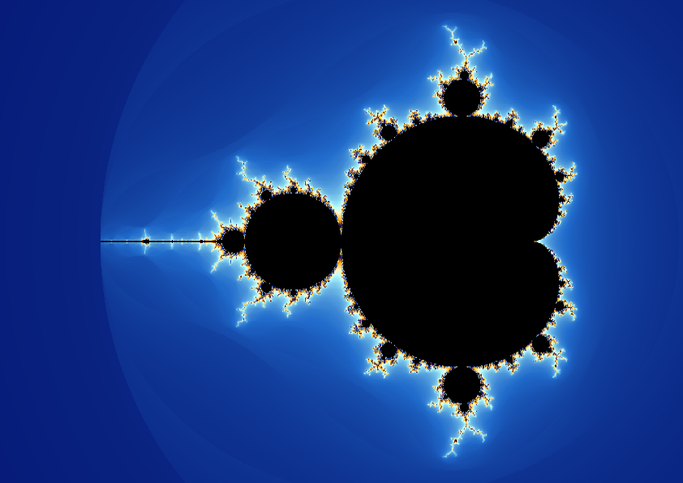

# A4 Mandelbrot in PostScript

`mandelbrot.ps` calculates the Mandelbrot set itself and prints exactly one A4
page. It needs PostScript LanguageLevel 2 or later. It uses no external files,
fonts, precomputed raster, native executable, or Ghostscript-specific operators.



## Choose a view

The first configurable declarations, immediately after the DSC header, are:

```postscript
/x (-0.75) def
/y (0) def
/zoom 0 def
```

Keep coordinates in parentheses: the program parses their decimal digits without
first rounding them to a native real. `zoom` is logarithmic to base two; fractional
levels are supported. Increasing it by one halves the sample spacing.

The following settings select `/landscape true` or `false`, `/marginMM 0`, and the
strip height. The switch itself runs only at setup; the two aspect ratios sample different
regions, so total rendering times can differ. The default is landscape. Zero requests full bleed; physical printer margins are reported and
the image uses the available printable area. Pixel rounding can leave a border
smaller than one sample. The image is never stretched.

The calculation resolution is set near the top of the PS file:

```postscript
/renderDPI 72 def
```

Positive values select a fixed sampling density, independent of the output
device's resolution. The default 72 dpi produces approximately 842 x 595 samples
on landscape A4. Lower values, such as 36, reduce calculation time. The image
still fills the same page area and keeps square samples.

Set `/renderDPI 0 def` to use the device's `HWResolution` instead. For unequal
horizontal and vertical resolutions, this uses the larger value on both axes.
Negative values are rejected. The PS file never changes the device resolution.

An optional Python helper copies URL parameters into another standalone PS file:

```sh
python3 tools/configure.py \
  --url 'https://apps.cafe-megabyte.de/mandelbrot/#x=-2&y=0&zoom=1200' \
  --output output/zoom1200.ps

python3 tools/configure.py --x=-0.75 --y=0 --zoom=0 --portrait \
  --output output/portrait.ps
```

The helper preserves coordinate text exactly. It does not calculate the image.

## Ghostscript

```sh
gs -dBATCH -dNOPAUSE -sDEVICE=png16m -r72 \
  -sOutputFile=preview.png mandelbrot.ps

gs -dBATCH -dNOPAUSE -sDEVICE=pdfwrite -r72 \
  -dAutoRotatePages=/None -dDownsampleColorImages=false \
  -dAutoFilterColorImages=false -dColorImageFilter=/FlateEncode \
  -sOutputFile=mandelbrot.pdf mandelbrot.ps
```

`-r72` selects a 72 dpi **output device** for these examples. Calculation stays
at `renderDPI`, which defaults to 72; only `renderDPI 0` makes the device setting
control sampling. Higher calculation DPI increases both sample count and, at
some thresholds, iteration count. `make preview DPI=72` and `make pdf DPI=72`
are equivalent shortcuts; their `DPI` option sets the output device resolution.

## Acrobat Distiller

Open the PS file in Distiller. Calculation defaults to 72 dpi regardless of its
job settings. Set `renderDPI` to another positive value to change calculation
detail, or to 0 to use Distiller's `HWResolution`. PDF has no fixed display
resolution. Disable image downsampling and lossy compression when retaining the
computed RGB detail matters. Disable automatic page rotation if the selected
orientation must be preserved. Distiller has not been available for local testing;
the implementation uses standard Level 2 operators and 32-bit-safe integer math.

## Accuracy and practical limits

- Escape is the first iteration with squared magnitude **greater than** four.
  Escape in the last permitted iteration is coloured correctly.
- An adaptive iteration budget matches the reference application's spacing rule.
  Black means no escape within that budget, or a proved interior certificate.
- The interpreter's real precision is measured. Native arithmetic, compensated pairs, and scaled
  perturbations carry forward error bounds. Ambiguous pixels are recomputed with
  outward fixed-point intervals and increasing precision, never painted black
  merely because a fast calculation failed.
- There is no selected maximum zoom such as 20, 80, or 1200. Separate binary
  exponents avoid real underflow. Available memory, PostScript object limits,
  signed iteration counters, and execution time are still finite, as in the web
  application. General difficult deep views can be much slower than the two
  supplied examples. This is a scalar PostScript program, not the browser's
  compiled SIMD/worker implementation.
- Native logarithms determine final RGB rounding. Tests allow one byte level per
  channel against an independent interval oracle. Interpreter colour management,
  PDF compression, and printing can subsequently change displayed colours.

See [numerical design](docs/numerics.md), [accepted implementation decisions](docs/implementation.md),
and [validation](docs/validation.md) for the proofs, resource model, and measured runs.

## Tests

Install Python 3 and Ghostscript, then run `make check`. Tests execute the actual
PostScript routines and compare them with a separate Python integer-interval
oracle. They cover all 4096 palette entries, signed fixed-point arithmetic,
decimal parsing, budget thresholds, exact escape rules, fractional zoom, symmetry,
and both supplied deep views. Rendering tests verify page orientation, clipping,
fixed and device-selected calculation resolution, strip reuse, and stack balance.

The numerical and palette conventions follow
[`cafe-megabyte/Mandelbrot` at `cd7d631`](https://github.com/cafe-megabyte/Mandelbrot/tree/cd7d63135096ac0f6ffe4d546422cc6f6c54d02f).
The arithmetic and PostScript implementation here are independent.

For measured device renders and reversible optimization comparisons, run
`python3 tools/benchmark.py --dpi 12` or add `--ablate --repeat 3`.
The benchmark's `--dpi` sets both calculation and output device resolution in
temporary PS copies; it does not change the original file.
